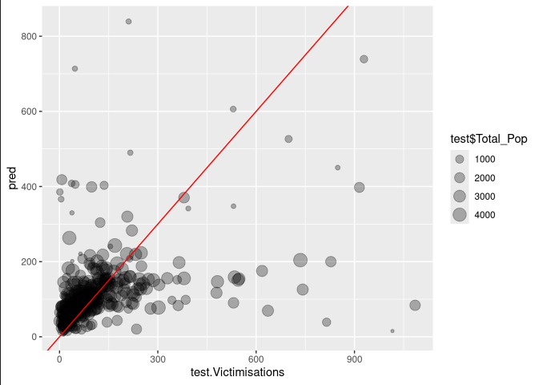
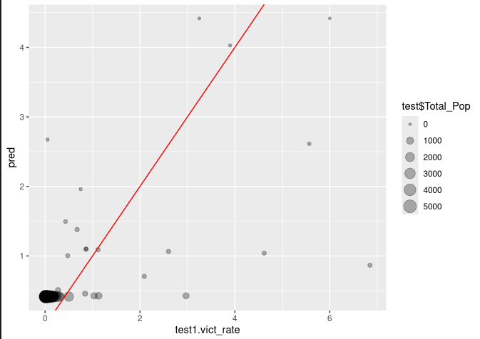
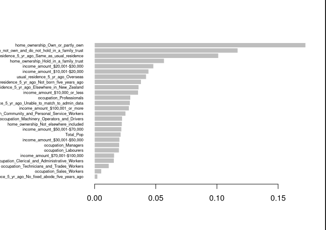
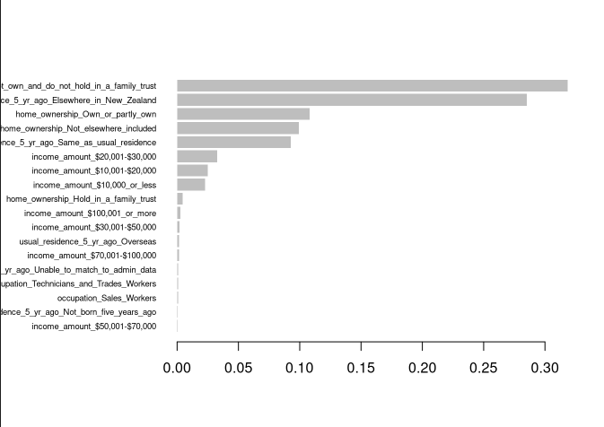
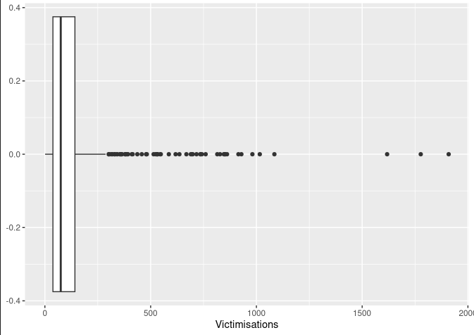
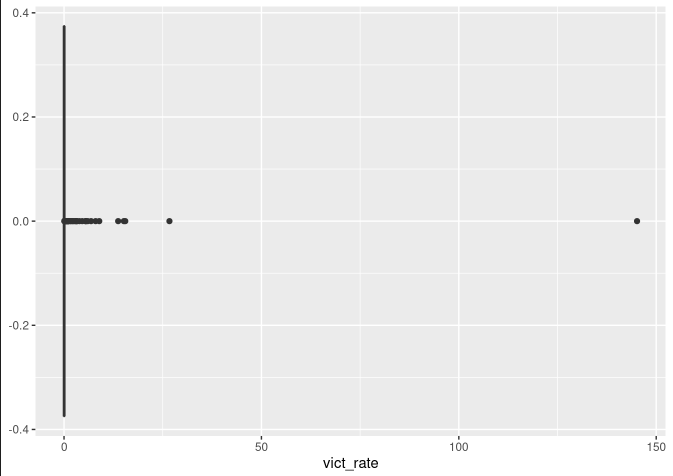

\newpage{}


# Goal
The main goal of this project is to see what features in census Statistical Area 2 (areas of 1,000 to 4,000 people) are the highest predictors of crime. This EDA is focusing on part two of the 2023 Census totals by topic for individuals by SA2 dataset.

# Data Source
The data for this analysis is coming from 3 main sources:   

|**Dataset**|**Detail**|**Dimensions**|
|--|--|--|
| [Census](https://2023census-statsnz.hub.arcgis.com/maps/29a82d5a0ea24a3880219bcb3df126dc/about)               | 2023 Census totals by topic for individuals by SA2 Part 2 | $2395 \times 862$ |
| [Meshblock](https://datafinder.stats.govt.nz/layer/111224-meshblock-higher-geographies-2023-generalised)      | Mapping table for meshblock to SA2 lookup          | $57539 \times 55$ |
| [Victimisations](https://public.tableau.com/app/profile/policedata.nz/viz/VictimisationsTimeandPlace/Summary) | Victimisation data with meshblock and timestamp    | $1133581 \times 17$ |

The ANZSOC_Full_data is from the NZ police, which has the place and month the reported victimization took place, and a meshblock to the SA2 table to join the police data. 
data with the census data, and for this write-up, I am looking at the main means of travel to work and the population change by ethnic group from the 
2023 New Zealand census. 

# Data Loading

## Missing/Redacted Data
Using the documentation from StatsNZ, any $-999$ is listed as a redacted value due to confidentiality, and $-997$ for no response. Since we do not have extra information to input these values, we can treat them as `NA`. In the Victimisation data, there are $7497$ meshblocks and area units that are redacted, so we cannot use those as well. There are also a few SA2s that have 0 recording for the census; once again, this can be ignored since there is no way of imputing any possible data to fill these empty spots, and these are likely areas with no residential population and are outliers.

## Date Range
The Victimisation data covers the range of 8/2021 to 7/2025, while the census has values for 2018 and 2023. Therefore, to get the most accurate predictions from the data, we are only going to look at data from 2023. The Victimisation data requires us to drop all columns that did not occur in 2023. Given this reduction in data size and increasing the likelihood of some Regions having none to a few data points, we also decided to focus on the 4 major cities of Auckland. This brought the victimization data to $173203$ observations. We have also applied this date range to the census data and dropped all columns that had data for 2013 and 2018.

## Data Dimensionality
The census data has over $800$ features, but a lot of these features are from the 2013 and 2018 census; we can drop those, as well as any features describing the land area. That brings us down to $304$ features that are broken down into multiple sections, such as individual home ownership, years at residence, study participation, and income. Each of these sections has a total number of responses and value, indicating the number of people who fall into each category.
Removing the missing data from the victimization data and filtering down to the relevant columns brings us to $7$ features and $173203$ rows. While the Meshblock we just keep the $2$ relant columns but keep all the rows.

## Data Transformations
In order to best reflect how crime is influenced by the neighborhood features, the three datasets were joined together to make a single table. In order not to have a few individual locations dominate the graphs, it was decided to look at the victimization rate instead of the totals, so it was divided by the total population of each SA2 to find the rate for that area.

| **Dataset**|**Original Size**|**Final Size**|
|--|--|--|
|Victimisation|$1133581 \times 17$|$173203 \times 7$|
|Meshblock|$57539 \times 55$|$57539 \times 2$|
|Census Totals by Topic|$2395 \times 862$ |$2395 \times 304$|
|Main EDA Data| |$3802 \times 307$ |

# Data Exploration

## Distribution of Committed Offenses

{ width=300px }

The majority of crimes are Theft by a large margin, while Sexual Offences and Robbery and blackmail are the least common types of crime. This breakdown is understandable since theft is a less serious type of crime that could just happen with items left out in public areas or people being pickpocketed in crowded areas.

## Criminal Activity Hotspots
### By Rate
|Statistical Area 2 Name  | Total Population| Total Victimisation | Crime Rate |
|:------------------------|------------------------|------------------------| ------------------------:|
|Botany Central | 30|1016 | 3387%|
|Mount Wellington Industrial          | 36| 267| 742%|
|Addington North             | 96 | 379| 395%|
|Riccarton Central        | 270 | 853| 316%|
|Sylvia Park         | 585| 1618| 277%|
 
Most of the areas with high rates seem to be areas with a low residential population but a high amount of traffic, such as parks and business centers.

\newpage{}

### By Total
|Statistical Area 2 Name  | Total Population| Total Victimisation | Crime Rate |
|:------------------------|------------------------|------------------------| ------------------------:|
|Te Rapa South |852|1909 | 224%|
|Hamilton Central          | 3582| 1777| 49.6%|
|Sylvia Park            | 585 | 1618| 277%|
|Linwood East        | 10800 | 1085| 10%|
|Botany Central Park         | 30| 1016| 3387%|

The areas with high totals of victimizations look to have some overlap with the areas of high rates, but there are now a few more highly populous areas in the mix. 

## Census breakdown
Due to the large number of columns and census groups, this only highlights a few of the most interesting trends.

### Home Ownership

{ width=300px }

Homeownership shows 3 major trends in victimization, as the rate of not owning in an SA2 increases, so does the victimization rate. This is the inverse for homes that are held in a family trust or owned, which show a downward trend. These trends are most likely correlated with the household wealth, such that areas with more ownership tend to have higher household wealth. There might also be a correlation with geographic location, with more people renting in city centers, while more people own their houses if they are not in the city center. These trends indicate that these features are worth including in the future model.

\newpage{}

### Location 5 Years ago

{ width=300px }

A clear trend is that if individuals were located in the same SA2 as they were five years ago, there is a downward trend in victimization. This might indicate that people feel safer in neighborhoods with less crime, so they are more likely to stay. There is an upward trend for people who were located elsewhere in New Zealand five years ago. Since this EDA is looking at the 4 major cities, this trend might be related to individuals recently moving into the major cities (such as students or recent graduates) and being located in more centralized areas. Since there is such a distinct trend long-term occupancy is worth including in the model

### Education

{ width=300px }

Education only shows slight trends in the data with minor downward trends for having and education level. However, the data is so clustered due to the spread of possible values that it cannot be directly determined using this graph if there is an overall trend.


After grouping some categories together into larger sections, the trends are slightly more pronounced but still very slight. The main trend the graph shows is that SA2 with higher rates of any form of education qualification reduces the rate of Victimisation. But since this trend is so slight, this category can be ignored.

[see in Appendix](###Education Qualifications)

### Income

{ width=300px }

Outside of making $\$70,001+$ per year, there seems to be an upward trend in the victimization rate for all income brackets. While it makes sense that more wealthy SA2 would have a low crime rate, what is interesting is that the general trend seems to be an increase in the crime rate when there are more people with incomes between $\$10000 - \$70000$. Since the highest crime type is theft, this might indicate that in the SA2 with lower income rates, there might be less theft, which then increases as the area's income increases up to the super-rich, who probably have more security and are not targeted as much. With this divide, it might be worth combining the data in these columns down to lower, middle, and high income and using those in the model, but these features are not worth looking at independently.

### Job Industry

{ width=300px }

Most of the job types have a slight downward trend or no discernible trend; the main exception is Accommodation and Food Service. This may be due to such roles having lower salaries, which has the individuals living in less affluent areas and/or being frequently exposed to the public. By limiting this analysis to just the major cities, there may be trends not being captured, such as areas with much higher mining employment and/or gas extraction. While this is an interesting result, it does not work when adding to the model, since in most cases the rate of occupation type has no major influence on the crime rate.


# Analytical Plan
The next step would be establishing relationships between all predictors against a normalized count of victimizations (/ 1000 Households).
There is a strong potential for income and crowding to explain the number of victimizations, hence the possibility (polynomial) of a non-linear relationship would be explored. All the socio-economic factors, such as vehicle ownership and access to telecommunication, should be examined in correlation with income and crowding.
Establish a geographic context by comparing the patterns in the city center, suburban, and rural settings.
Observe the outcome of the backward model selection based on these factors.
Build a regression model to predict potential high-risk areas based on predictors. Since most explanatory variables here are numeric, XGBoost may be used.
Observe the effects of excluding outliers.
Identify and implement ways for effective visual geographical reporting.
Use LASSO and RIDGE regression to find the best combination of variables and make the model more general.

# Modeling
## Data
The main features used in creating the model were Homeownership, Location 5 years ago, Occupation, and Income.
These features had the highest correlation with the victimisation rate, as shown in the EDA, so they should produce the best predictions of the given subset. Given that the correlations were with the log of the features, the model will be trained on the log of the census values. Other than taking the log, most of the data preparation is the same as the steps done in the EDA.

The data has been split into a Train and Test set, with the Train containing $80\%$ of the data set.

## Model
With its high performance in predicting continuous values, XGBoost was used to build the preliminary model. XGBoost performs well on non-linear relationships and is robust to outliers.  The `xgboost` package was used due to the ease of implementing cross-validation to find the best parameters. For developing the first model, the following parameters were used in the cross-validation:

|Parameter | Value|
|:------------------------| ------------------------:|
|$\eta$ |$.01$|
|$\gamma$| $4$|
|max_depth| $7$ |
|subsample| $0.8$ |
|colsample_bytree| $0.5$|

This helped identify the total depth for the final model.

### Results
The model has a high RMSE on the test of $143.7885$, indicating that victimisation predictions are, on average, far away from the true value. The figure illustrates how close model predictions are to the true value.

{ width=300px }

There is a clustering towards the bottom, where there are few victimizations, and the model predicts the same. However, the model massively under-predicts and over-predicts some regions. The SA2 with lower populations tends to have worse predictions, which indicates other relations outside of what the census can capture.

| SA2 | Total Pop | Victimisation | Prediction | Diff |
|:------------------------|----|------|--------|------------------------:|
|Linwood East|$2160$| $1085$ | $83.83416$ | $1001.1658$ |
|Botany Central | $6$ | $1016$ | $15.31698$ | $1000.6830$ |
|Takanini Central| $1110$ | $815$ | $38.78600$ | $776.2140$ |
|Middleton| $204$ | $47$ | $713.64136$ | $666.6414$ |
|Henderson Lincoln East| $210$| $211$ | $839.14795$ | $628.1479$ |

These are the regions with a large prediction difference. Botany Central has a very low population but a high Victimisation rate. This is due to it hosting a large commercial center, which attracts people, but lacks a resident population that provides useful census data. Middleton has a very high prediction but a low Victimisation amount. The variable importance graph illustrates what the model is picking up on. Middleton has a high percentage of home ownership, with a low amount of people who do not own and do not hold property in a family trust (165), and a high percentage of people from elsewhere in New Zealand (120). The model considers home ownership, not owning, and not holding in a family trust, as well as usual residence 5 years ago elsewhere in New Zealand, as some of the more important variables. The EDA revealed that these features exhibit a positive correlation with Victimisation, which is skewing the result due to the high proportion of these values.

When we use the mean of the train as the prediction, we get an RMSE of $82.28026$, indicating that the outliers are skewing the model's results.

Using the Victimization Rate instead of the total number of Victimization does slightly improve the model's predictive power while reducing the number of sub-models.

{ width=300px }

The victimization rate model produces an RMSE of $0.6003056$ while the mean of the train produces an RMSE of  $0.4065027$. Examining how the predictions map to the true value once again shows that the model performed well on most SA2; the outliers are all areas with lower population. This reinforces the hypothesis that commercial areas are skewing the results.


### Feature Importance
As illustrated in the previous section, the feature importance can indicate what features contribute the most to the model's prediction.
{ width=300px }

Given the subset of census data the model was trained on, the most important features are owning or partially owning a home, income of 20,000-30,000, and not owning a home. Not having a permanent abode 5 years ago, being a sales worker, and being a clerk have the least importance for the model. This indicates that the number of people who own or partially own a house has a large impact on the With this subset, examining the economic data from the census does not provide a full view of neighborhood conditions.

{ width=300px }

For the victimization rate model, the feature importance changes with multiple features having a negligible impact on the predictive power of the model. The two most important features are not owning a house or being from elsewhere in New Zealand. These features likely correlate with more Urban SA2s instead of the suburbs, which, given a higher mix of people and commercial areas, have a higher crime rate.

### Next Steps
To improve the model, adding demographic and health data can help round out the picture of neighborhoods and possibly improve the model's prediction. There can also be further work in optimizing hyperparameters and removing the less important features. As discussed in the analytical plan, focusing on the type of victimization might also provide higher results (excluding theft from the model). Another option may be to remove areas with a low population since they are massive outliers. However, they are valid data points, so there may be unintended consequences for removing them. Grid Search can also be used on the larger dataset to find the parameters that provide the best performance.

# Discussion
While the model had poor performance, it was trained on a small subset of the census data that just captured the economic conditions of different SA2s. When examining the spread of the victimization data from the whole data set:

## Number of Victimization

{ width=200px }

```
    Min. 1st Qu.  Median    Mean 3rd Qu.    Max. 
     1.0    38.0    75.0   123.9   142.0  1909.0
```

## Victimization Rate

{ width=200px }


```
      Min.   1st Qu.    Median      Mean   3rd Qu.      Max. 
   0.00032   0.01599   0.03073   0.37658   0.05339 145.14286
```

While most of the data is clustered in a small band, there is a large spread of values and extreme outliers. Given that some outliers lack a large population (commercial zones), they are hard to predict, given the available data. Some of the outliers may be improved by adding demographic and health data, while removing the less important economic features, such as working in sales.

Two other issues are the census data capturing a snapshot of March 2023, while the police data is for a whole year, and police reporting bias. While the temporal aspect cannot be controlled, the census data provides a fair snapshot of most neighborhoods since there is not a 100% yearly churn in an SA2. Police bias (higher security presence leading to higher reporting) is much harder to control for, but it is a consistent bias throughout the data set.


\newpage{}
# Appendix
## Setup
```{r setup, results = "hide"}
library(Hmisc, include.only = c('describe'))
library("tidyverse")
library(grid)
library(gridExtra)
library(hexbin)
library(caret)
library(xgboost)
```
### Load and Format Victimisation
```{r Load-and-Format-Victimization, cache=T}

# Read in crime data and filter to relevant columns
crime_data = read.csv("data/ANZSOC_Full Data_data.csv") |>
 mutate(Year.Month = my(Year.Month)) |>
 mutate(Month = month(Year.Month), Year = year(Year.Month))|>
 select(ANZSOC.Division, Victimisations, Meshblock,
 Territorial.Authority, Month, Year, Year.Month)
# describe(crime_data)

focused_crime = crime_data |> # limmiting data to the 4 major NZ cities
  filter(Year == 2023 & Territorial.Authority
  %in% c("Auckland.", "Wellington City.", "Hamilton City.", "Christchurch City.")) 
# describe(focused_crime)
```
### Crime Distribution
```{r eval=F}
# Pie chart of crime type distribution
crime_data |>
 group_by(ANZSOC.Division) |>
 dplyr::summarize(count_by_subdivision = sum(Victimisations, 
    na.rm = T), 
    .groups = "drop") |>
 ggplot(aes(x = "", 
               y = count_by_subdivision,
               fill = `ANZSOC.Division`)) +
 geom_bar(stat = "identity", width = 1) +
 scale_fill_viridis_d(direction = -1) +
 coord_polar("y", start = 0) +
 labs(
        title = "Distribution of Committed Offenses",
        x = "",
        y = ""
    ) +
 theme_minimal()
```

### Missing Data
```{r Missing-Locations, cache=T}
# number of missing locations
missing_loc = crime_data |> filter(Meshblock < 0) |> nrow()
cat("missing location data: ", missing_loc,'\n')
```

### Load in Meshblock
```{r Load-in-Meshblock-Data, cache=T}
# load in meshblock data
names = c("MB2023_V1_00" = "Meshblock", "SA22023_V1_00" = "SA2")
meshblock_data = read.csv(
  "data/meshblock-higher-geographies-2023-generalised.csv"
) |> 
 select(MB2023_V1_00, SA22023_V1_00) |>
 rename(
         SA2 = SA22023_V1_00,
         Meshblock = MB2023_V1_00)

# describe(meshblock_data)
```

### Load in Census data
```{r Load-and-Transform-Census, cache=T}
# load in census
census = read_csv(
  "data/2023_Census_totals_by_topic_for_individuals_by_SA2_299028350473552691.csv",
  na = c("", "NA", -999, -997), show_col_types = FALSE) |>
 select(!contains("2018")) |> # remove unneccary dates
 select(!contains("2013")) |>
 select(!contains("Shape")) |>
 select(!contains("kilometres")) |>
 rename(SA2 = `Statistical area 2 (SA2) 2023 code`) |>
 rename(Total_Pop = `Subject pop: Census usually resident population count, Year: 2023, Measure: Count, Var1: Individual unit data source (Total)`)

census[is.na(census)] = 0
ncol(census)
```

### Combining all Data
```{r Join-Data, cache=T}
# joining crime to SA2
crime_SA2 = inner_join(
 focused_crime,
 meshblock_data,
                      by = "Meshblock")

total_crime_sa2 = crime_SA2 |>
 group_by(SA2, Territorial.Authority) |>
 summarise_at("Victimisations", sum) |>
 inner_join(census, by = "SA2")

```

## Crime Totals
```{r totals, cache=T}
totals = total_crime_sa2 |>
 group_by(`Statistical area 2 (SA2) 2023 name`) |>
  filter(Total_Pop > 1) |>
 summarise(total_pop = sum(Total_Pop, na.rm = TRUE),
            total_vit = sum(Victimisations, na.rm = TRUE),
            crime_rate = sum(Victimisations, na.rm = TRUE) / sum(Total_Pop, na.rm = TRUE) * 100)
totals |> arrange(desc(crime_rate))
totals |> arrange(desc(total_vit))
```

## Homeownership
```{r homeownership, fig.width=8, fig.height=8, warning=F, cashe =T}
long = total_crime_sa2 |> rename_with(
  ~ str_replace(.x, 
                  "Subject pop: Census usually resident population count aged 15 years and over, Year: 2023, Measure: Count, Var1: Individual home ownership \\((.+)\\)",
                  "pop over 15 \\1") |>
 str_replace_all(" ", "_") 
) |> 
 group_by(SA2) |>
 mutate(
 across(starts_with("pop_over_15_"), ~ sum(.x, na.rm = TRUE) / sum(Total_Pop, na.rm = TRUE)),
    Vict_rate = sum(Victimisations, na.rm = TRUE) / sum(Total_Pop, na.rm = TRUE)
  ) |>
 pivot_longer(
    cols = starts_with("pop_over_15_"),
    names_to = "home_ownership_type",
    values_to = "proportion"
  ) |>
 mutate(
    home_ownership_type = str_remove(home_ownership_type, "pop_over_15_"),
    home_ownership_type = str_replace_all(home_ownership_type, "_", " "),
    home_ownership_type = str_to_title(home_ownership_type)
  ) |>
 select(c("home_ownership_type", "proportion", "Vict_rate", "Total_Pop")) |>
  filter(!str_detect(home_ownership_type, "Total"))
long |>
 ggplot(aes(x=proportion, y=log(Vict_rate), color = Total_Pop)) +
 geom_point() +
 geom_smooth(method = "lm", se = TRUE, color='red') +
 facet_wrap(~ home_ownership_type, scales = "free_y") +
 labs(
    x = "Home Ownership Rate",
    y = "Victimization Rate",
    title = "Victimization Rate by Home Ownership"
  )
```

## Residency 
### Previous Year
```{r Usually-residence-1, fig.width=8, fig.height=8, warning=F, cashe =T}
long = total_crime_sa2 |> rename_with(
  ~ str_replace(.x, 
                  "Subject pop: Census usually resident population count, Year: 2023, Measure: Count, Var1: Usual residence 1 year ago indicator \\((.+)\\)",
                  "usual_residence_1_yr_ago \\1") |>
 str_replace_all(" ", "_") 
) |>
 group_by(SA2) |>
 mutate(
 across(starts_with("usual_residence_1_yr_ago"), ~ sum(.x, na.rm = TRUE) / sum(Total_Pop, na.rm = TRUE)),
    Vict_rate = sum(Victimisations, na.rm = TRUE) / sum(Total_Pop, na.rm = TRUE)
  ) |>
 mutate(
 across(starts_with("usual_residence_1_yr_ago"), ~ sum(.x, na.rm = TRUE) / sum(Total_Pop, na.rm = TRUE))
  ) |>
 pivot_longer(
    cols = starts_with("usual_residence_1_yr_ago"),
    names_to = "comes_from",
    values_to = "proportion"
  ) |>
 mutate(
    comes_from = str_remove(comes_from, "usual_residence_1_yr_ago"),
    comes_from = str_replace_all(comes_from, "_", " "),
    comes_from = str_to_title(comes_from)
  ) |>
 select(c("comes_from", "proportion", "Vict_rate", "Total_Pop")) |>
  filter(!str_detect(comes_from, "Total"))

long |>
 ggplot(aes(x=proportion, y=log(Vict_rate), color = Total_Pop)) +
 geom_point() +
 geom_smooth(method = "lm", se = TRUE, color='red') +
 facet_wrap(~ comes_from, scales = "free_y") +
 labs(
    x = "Rate in SA2 of Indivuals from Place",
    y = "Victimization Rate",
    title = "Victimization Rate by Location 1 Year ago"
  )
```

### Residency Five Years ago
```{r Usually-residence-5, fig.width=8, fig.height=8, warning=F, cashe =T}
long = total_crime_sa2 |> rename_with(
  ~ str_replace(.x, 
                  "Subject pop: Census usually resident population count, Year: 2023, Measure: Count, Var1: Usual residence 5 years ago indicator \\((.+)\\)",
                  "usual_residence_5_yr_ago \\1") |>
 str_replace_all(" ", "_") 
) |>
 group_by(SA2) |>
 mutate(
 across(starts_with("usual_residence_5_yr_ago"), ~ sum(.x, na.rm = TRUE) / sum(Total_Pop, na.rm = TRUE)),
    Vict_rate = sum(Victimisations, na.rm = TRUE) / sum(Total_Pop, na.rm = TRUE)
  ) |>
 pivot_longer(
    cols = starts_with("usual_residence_5_yr_ago"),
    names_to = "comes_from",
    values_to = "proportion"
  ) |>
 mutate(
    comes_from = str_remove(comes_from, "usual_residence_5_yr_ago"),
    comes_from = str_replace_all(comes_from, "_", " "),
    comes_from = str_to_title(comes_from)
  ) |>
 select(c("comes_from", "proportion", "Vict_rate", "Total_Pop")) |>
  filter(!str_detect(comes_from, "Total"))

long |>
 ggplot(aes(x=proportion, y=log(Vict_rate), color = Total_Pop)) +
 geom_point() +
 geom_smooth(method = "lm", se = TRUE, color='red') +
 facet_wrap(~ comes_from, scales = "free_y") +
 labs(
    x = "Rate in SA2 of Indivuals from Place",
    y = "Victimization Rate",
    title = "Victimization Rate by Location 5 Year ago"
  )
```

### Years at Residence
```{r years-at-residence, fig.width=8, fig.height=8, warning=F, cashe =T}
long = total_crime_sa2 |> rename_with(
  ~ str_replace(.x, 
                  "Subject pop: Census usually resident population count, Year: 2023, Measure: Count, Var1: Years at usual residence \\((.+)\\)",
                  "years_at_residence \\1") |>
 str_replace_all(" ", "_") 
) |> 
 group_by(SA2) |>
 mutate(
 across(starts_with("years_at_residence"), ~ sum(.x, na.rm = TRUE) / sum(Total_Pop, na.rm = TRUE)),
    Vict_rate = sum(Victimisations, na.rm = TRUE) / sum(Total_Pop, na.rm = TRUE)
  ) |>
 pivot_longer(
    cols = starts_with("years_at_residence"),
    names_to = "years_at_residence",
    values_to = "proportion"
  ) |>
 mutate(
    years_at_residence = str_remove(years_at_residence, "years_at_residence"),
    years_at_residence = str_replace_all(years_at_residence, "_", " "),
    years_at_residence = str_to_title(years_at_residence)
  ) |>
 select(c("years_at_residence", "proportion", "Vict_rate", "Total_Pop")) |>
  filter(!str_detect(years_at_residence, "Total"))

long |>
 ggplot(aes(x=proportion, y=log(Vict_rate), color = Total_Pop)) +
 geom_point() +
 geom_smooth(method = "lm", se = TRUE, color='red') +
 facet_wrap(~ years_at_residence, scales = "free_y") +
 labs(
    x = "SA2 Rate of Stay at Residence",
    y = "Victimization Rate",
    title = "Victimization Rate by Years at Residence"
  )
```

### Time in NZ
```{r overseas_stay_duration, fig.width=8, fig.height=8, warning=F, cashe =T}
long = total_crime_sa2 |> rename_with(
  ~ str_replace(.x, 
                  "Subject pop: Overseas-born census usually resident population count, Year: 2023, Measure: Count, Var1: Years since arrival in New Zealand \\((.+)\\)",
                  "overseas_stay_duration \\1") |>
 str_replace_all(" ", "_") 
) |>
 group_by(SA2) |>
 mutate(
 across(starts_with("overseas_stay_duration"), ~ sum(.x, na.rm = TRUE) / sum(Total_Pop, na.rm = TRUE)),
    Vict_rate = sum(Victimisations, na.rm = TRUE) / sum(Total_Pop, na.rm = TRUE)
  ) |>
 pivot_longer(
    cols = starts_with("overseas_stay_duration"),
    names_to = "overseas_stay_duration",
    values_to = "proportion"
  ) |>
 mutate(
    overseas_stay_duration = str_remove(overseas_stay_duration, "overseas_stay_duration"),
    overseas_stay_duration = str_replace_all(overseas_stay_duration, "_", " "),
    overseas_stay_duration = str_to_title(overseas_stay_duration)
  ) |>
 select(c("overseas_stay_duration", "proportion", "Vict_rate", "Total_Pop")) |>
  filter(!str_detect(overseas_stay_duration, "Total"))

long |>
 ggplot(aes(x=proportion, y=log(Vict_rate), color = Total_Pop)) +
 geom_point() +
 geom_smooth(method = "lm", se = TRUE, color='red') +
 facet_wrap(~ overseas_stay_duration, scales = "free_y") +
 labs(
    x = "SA2 Rate of Overseas Stay Duration",
    y = "Victimization Rate",
    title = "Victimization Rate by Overseas Stay Duration"
  )
```

## Education
### Student Type
```{r study_participation, fig.width=8, fig.height=8, warning=F, cashe =T}
long = total_crime_sa2 |> rename_with(
  ~ str_replace(.x, 
                  "Subject pop: Census usually resident population count, Year: 2023, Measure: Count, Var1: Study participation \\((.+)\\)",
                  "study_participation \\1") |>
 str_replace_all(" ", "_") 
) |>
 group_by(SA2) |>
 mutate(
 across(starts_with("study_participation"), ~ sum(.x, na.rm = TRUE) / sum(Total_Pop, na.rm = TRUE)),
    Vict_rate = sum(Victimisations, na.rm = TRUE) / sum(Total_Pop, na.rm = TRUE)
  ) |>
 pivot_longer(
    cols = starts_with("study_participation"),
    names_to = "study_participation",
    values_to = "proportion"
  ) |>
 mutate(
    study_participation = str_remove(study_participation, "study_participation"),
    study_participation = str_replace_all(study_participation, "_", " "),
    study_participation = str_to_title(study_participation)
  ) |>
 select(c("study_participation", "proportion", "Vict_rate", "Total_Pop")) |>
  filter(!str_detect(study_participation, "Total"))

long |>
 ggplot(aes(x=proportion, y=log(Vict_rate), color = Total_Pop)) +
 geom_point() +
 geom_smooth(method = "lm", se = TRUE, color='red') +
 facet_wrap(~ study_participation, scales = "free_y") +
 labs(
    x = "SA2 Rate of Study Participation",
    y = "Victimization Rate",
    title = "Victimization Rate by Study Participation"
  )
```

### Education Qualifications
```{r highest_qual, fig.width=8, fig.height=8, warning=F, cashe =T}
long = total_crime_sa2 |> rename_with(
  ~ str_replace(.x, 
                  "Subject pop: Census usually resident population count aged 15 years and over, Year: 2023, Measure: Count, Var1: Highest qualification \\((.+)\\)",
                  "highest_qualification \\1") |>
 str_replace_all(" ", "_") 
) |>
 group_by(SA2) |>
 mutate(
 across(starts_with("highest_qualification"), ~ sum(.x, na.rm = TRUE) / sum(Total_Pop, na.rm = TRUE)),
    Vict_rate = sum(Victimisations, na.rm = TRUE) / sum(Total_Pop, na.rm = TRUE)
  ) |>
 pivot_longer(
    cols = starts_with("highest_qualification"),
    names_to = "highest_qualification",
    values_to = "proportion"
  ) |>
 mutate(
    highest_qualification = str_remove(highest_qualification, "highest_qualification"),
    highest_qualification = str_replace_all(highest_qualification, "_", " "),
    highest_qualification = str_to_title(highest_qualification)
  ) |>
 select(c("highest_qualification", "proportion", "Vict_rate", "Total_Pop")) |>
  filter(!str_detect(highest_qualification, "Total"))

long |>
 ggplot(aes(x=proportion, y=log(Vict_rate), color = Total_Pop)) +
 geom_point() +
 geom_smooth(method = "lm", se = TRUE, color='red') +
 facet_wrap(~ highest_qualification, scales = "free_y") +
 labs(
    x = "SA2 Rate of Qualification",
    y = "Victimization Rate",
    title = "Victimization Rate by Highest Qualifications"
  )

long |>
 mutate(
  highest_qualification = case_when(
 highest_qualification %in% c(" Masters Degree", " Post-Graduate And Honours Degrees", ' Doctorate Degree') ~ "Postgrad",
 highest_qualification %in% c(" Bachelor Degree And Level 7 Qualification") ~ "Bachelor",
 highest_qualification %in% c(" Level 6 Diploma", " Level 5 Diploma") ~ "Diploma",
 highest_qualification %in% c(" Level 4 Certificate", " Level 3 Certificate", " Level 2 Certificate", " Level 1 Certificate") ~ "Certificate",
    TRUE ~ highest_qualification
  )
 ) |>
 ggplot(aes(x=proportion, y=log(Vict_rate), color = Total_Pop)) +
 geom_point() +
 geom_smooth(method = "lm", se = TRUE, color='red') +
 facet_wrap(~ highest_qualification, scales = "free_y") +
 labs(
    x = "SA2 Rate of Qualification",
    y = "Victimization Rate",
    title = "Victimization Rate by Highest Qualifications"
  )
```

## Income
### Source
```{r income_source, fig.width=8, fig.height=8, warning=F, cashe =T}
long = total_crime_sa2 |> rename_with(
  ~ str_replace(.x, 
                  "Subject pop: Census usually resident population count aged 15 years and over, Year: 2023, Measure: Count, Var1: Sources of personal income \\((.+)\\)",
                  "income_source \\1") |>
 str_replace_all(" ", "_") 
) |>
 group_by(SA2) |>
 mutate(
 across(starts_with("income_source"), ~ sum(.x, na.rm = TRUE) / sum(Total_Pop, na.rm = TRUE)),
    Vict_rate = sum(Victimisations, na.rm = TRUE) / sum(Total_Pop, na.rm = TRUE)
  ) |>
 pivot_longer(
    cols = starts_with("income_source"),
    names_to = "income_source",
    values_to = "proportion"
  ) |>
 mutate(
    income_source = str_remove(income_source, "income_source"),
    income_source = str_replace_all(income_source, "_", " "),
    income_source = str_to_title(income_source)
  ) |>
 select(c("income_source", "proportion", "Vict_rate", "Total_Pop")) |>
  filter(!str_detect(income_source, "Total"))

long |>
 ggplot(aes(x=proportion, y=log(Vict_rate), color = Total_Pop)) +
 geom_point() +
 geom_smooth(method = "lm", se = TRUE, color='red') +
 facet_wrap(~ income_source, scales = "free_y") +
 labs(
    x = "SA2 Rate of Income Source",
    y = "Victimization Rate",
    title = "Victimization Rate by Income Source"
  )
```

### Amount
```{r income_amount, fig.width=8, fig.height=8, warning=F, cashe =T}
long = total_crime_sa2 |> rename_with(
  ~ str_replace(.x, 
                  "Subject pop: Census usually resident population count aged 15 years and over, Year: 2023, Measure: Count, Var1: Total personal income \\((.+)\\)",
                  "income_amount \\1") |>
 str_replace_all(" ", "_") 
) |>
 group_by(SA2) |>
 mutate(
 across(starts_with("income_amount"), ~ sum(.x, na.rm = TRUE) / sum(Total_Pop, na.rm = TRUE)),
    Vict_rate = sum(Victimisations, na.rm = TRUE) / sum(Total_Pop, na.rm = TRUE)
  ) |>
 pivot_longer(
    cols = starts_with("income_amount"),
    names_to = "income_amount",
    values_to = "proportion"
  ) |>
 mutate(
    income_amount = str_remove(income_amount, "income_amount"),
    income_amount = str_replace_all(income_amount, "_", " "),
    income_amount = str_to_title(income_amount)
  ) |>
 select(c("income_amount", "proportion", "Vict_rate", "Total_Pop")) |>
  filter(!str_detect(income_amount, "Total"))

long |>
 ggplot(aes(x=proportion, y=log(Vict_rate), color = Total_Pop)) +
 geom_point() +
 geom_smooth(method = "lm", se = TRUE, color='red') +
 facet_wrap(~ income_amount, scales = "free_y") +
 labs(
    x = "SA2 Rate of Income Amount",
    y = "Victimization Rate",
    title = "Victimization Rate by Income Amount"
  )
```

## Job
### Type
```{r job_type, fig.width=8, fig.height=8, warning=F, cashe =T}
long = total_crime_sa2 |> rename_with(
  ~ str_replace(.x, 
                  "Subject pop: Census usually resident population count aged 15 years and over, Year: 2023, Measure: Count, Var1: Work and labour force status \\((.+)\\)",
                  "job_type \\1") |>
 str_replace_all(" ", "_") 
) |>
 group_by(SA2) |>
 mutate(
 across(starts_with("job_type"), ~ sum(.x, na.rm = TRUE) / sum(Total_Pop, na.rm = TRUE)),
    Vict_rate = sum(Victimisations, na.rm = TRUE) / sum(Total_Pop, na.rm = TRUE)
  ) |>
 pivot_longer(
    cols = starts_with("job_type"),
    names_to = "job_type",
    values_to = "proportion"
  ) |>
 mutate(
    job_type = str_remove(job_type, "job_type"),
    job_type = str_replace_all(job_type, "_", " "),
    job_type = str_to_title(job_type)
  ) |>
 select(c("job_type", "proportion", "Vict_rate", "Total_Pop")) |>
  filter(!str_detect(job_type, "Total"))

long |>
 ggplot(aes(x=proportion, y=log(Vict_rate), color = Total_Pop)) +
 geom_point() +
 geom_smooth(method = "lm", se = TRUE, color='red') +
 facet_wrap(~ job_type, scales = "free_y") +
 labs(
    x = "SA2 Rate of Job Type",
    y = "Victimization Rate",
    title = "Victimization Rate by Job Type"
  )
```

### Industry
```{r industry, fig.width=8, fig.height=8, warning=F, cashe =T}
long = total_crime_sa2 |> rename_with(
  ~ str_replace(.x, 
                  "Subject pop: Employed census usually resident population count aged 15 years and over, Year: 2023, Measure: Count, Var1: Industry, by usual residence address \\((.+)\\)",
                  "industry \\1") |>
 str_replace_all(" ", "_") 
) |>
 group_by(SA2) |>
 mutate(
 across(starts_with("industry"), ~ sum(.x, na.rm = TRUE) / sum(Total_Pop, na.rm = TRUE)),
    Vict_rate = sum(Victimisations, na.rm = TRUE) / sum(Total_Pop, na.rm = TRUE)
  ) |>
 pivot_longer(
    cols = starts_with("industry"),
    names_to = "industry",
    values_to = "proportion"
  ) |>
 mutate(
    industry = str_remove(industry, "industry"),
    industry = str_replace_all(industry, "_", " "),
    industry = str_to_title(industry)
  ) |>
 select(c("industry", "proportion", "Vict_rate", "Total_Pop")) |>
  filter(!str_detect(industry, "Total"))

long |>
 ggplot(aes(x=proportion, y=log(Vict_rate), color = Total_Pop)) +
 geom_point() +
 geom_smooth(method = "lm", se = TRUE, color='red') +
 facet_wrap(~ industry, scales = "free_y") +
 labs(
    x = "SA2 Rate of Industry Workers",
    y = "Victimization Rate",
    title = "Victimization Rate by Industry Workers"
  )
```

### Occupation
```{r occupation, fig.width=8, fig.height=8, warning=F, cashe =T}
long = total_crime_sa2 |> rename_with(
  ~ str_replace(.x, 
                  "Subject pop: Employed census usually resident population count aged 15 years and over, Year: 2023, Measure: Count, Var1: Occupation, by usual residence address \\((.+)\\)",
                  "occupation \\1") |>
 str_replace_all(" ", "_") 
) |>
 group_by(SA2) |>
 mutate(
 across(starts_with("occupation"), ~ sum(.x, na.rm = TRUE) / sum(Total_Pop, na.rm = TRUE)),
    Vict_rate = sum(Victimisations, na.rm = TRUE) / sum(Total_Pop, na.rm = TRUE)
  ) |>
 pivot_longer(
    cols = starts_with("occupation"),
    names_to = "occupation",
    values_to = "proportion"
  ) |>
 mutate(
    occupation = str_remove(occupation, "occupation"),
    occupation = str_replace_all(occupation, "_", " "),
    occupation = str_to_title(occupation)
  ) |>
 select(c("occupation", "proportion", "Vict_rate", "Total_Pop")) |>
  filter(!str_detect(occupation, "Total"))

long |>
 ggplot(aes(x=proportion, y=log(Vict_rate), color = Total_Pop)) +
 geom_point() +
 geom_smooth(method = "lm", se = TRUE, color='red') +
 facet_wrap(~ occupation, scales = "free_y") +
 labs(
    x = "SA2 Rate of Occupation",
    y = "Victimization Rate",
    title = "Victimization Rate by Occupation"
  )
```

### Sector
```{r sector, fig.width=8, fig.height=8, warning=F, cashe =T}
long = total_crime_sa2 |> rename_with(
  ~ str_replace(.x, 
                  "Subject pop: Employed census usually resident population count aged 15 years and over, Year: 2023, Measure: Count, Var1: Sector of ownership \\((.+)\\)",
                  "sector_ \\1") |>
 str_replace_all(" ", "_") 
) |>
 group_by(SA2) |>
 mutate(
 across(starts_with("sector"), ~ sum(.x, na.rm = TRUE) / sum(Total_Pop, na.rm = TRUE)),
    Vict_rate = sum(Victimisations, na.rm = TRUE) / sum(Total_Pop, na.rm = TRUE)
  ) |>
 pivot_longer(
    cols = starts_with("sector_"),
    names_to = "sector",
    values_to = "proportion"
  ) |>
 mutate(
    sector = str_remove(sector, "sector"),
    sector = str_replace_all(sector, "_", " "),
    sector = str_to_title(sector)
  ) |>
 select(c("sector", "proportion", "Vict_rate", "Total_Pop")) |>
  filter(!str_detect(sector, "Total"))

long |>
 ggplot(aes(x=proportion, y=log(Vict_rate), color = Total_Pop)) +
 geom_point() +
 geom_smooth(method = "lm", se = TRUE, color='red') +
 facet_wrap(~ sector, scales = "free_y") +
 labs(
    x = "SA2 Rate of Sector",
    y = "Victimization Rate",
    title = "Victimization Rate by Sector"
  )
```

## Modeling
### Formatting Data
```{r train-test-formating, cache=T}
dataset = total_crime_sa2 |> 
  rename_with(~ .x |>
    str_replace("Subject pop: Census usually resident population count aged 15 years and over, Year: 2023, Measure: Count, Var1: Individual home ownership \\((.+)\\)",
                "home_ownership_\\1") |>
    str_replace("Subject pop: Employed census usually resident population count aged 15 years and over, Year: 2023, Measure: Count, Var1: Occupation, by usual residence address \\((.+)\\)",
                "occupation_\\1") |>
    str_replace("Subject pop: Census usually resident population count aged 15 years and over, Year: 2023, Measure: Count, Var1: Total personal income \\((.+)\\)",
                "income_amount_\\1") |>
    str_replace("Subject pop: Census usually resident population count, Year: 2023, Measure: Count, Var1: Usual residence 5 years ago indicator \\((.+)\\)",
                "usual_residence_5_yr_ago_\\1") |>
    str_replace_all(" ", "_")
  )  |>
  select(-starts_with("Subject") & -ends_with("_Total") & -contains("_Total_"))

parts = createDataPartition(dataset$Victimisations, p = .6, list = F)

train = dataset[parts,]
test = dataset[-parts,]
```

### Setting up Model
```{r param-list}
param_list = list(
  objective = "reg:linear",
  eta = 0.01,
  gamma = 4,
  max_depth = 7,
  subsample = 0.8,
  colsample_bytree = 0.5
)

```

### Full Data
```{r model-cv}

trainM = as.matrix(
    train |> select(
      -c(`SA2`, `Territorial.Authority`, 
      `OBJECTID`, `Statistical_area_2_(SA2)_2023_name`, 
      `Statistical_area_2_(SA2)_2023_name_no_macrons`, 
      Victimisations)))
      
testM = as.matrix(
    test |> select(
      -c(`SA2`, `Territorial.Authority`,
       `OBJECTID`, `Statistical_area_2_(SA2)_2023_name`, 
       `Statistical_area_2_(SA2)_2023_name_no_macrons`, 
       Victimisations)))

Dtrain = xgb.DMatrix(
  data = trainM[,-1], label = train$Victimisations)
Dtest = xgb.DMatrix(data = testM[,-1], label = test$Victimisations)

xgb.cv(params =  param_list,
              data = Dtrain,
              nrounds = 1000,
              nfold = 5,
              print_every_n = 10,
              early_stopping_rounds = 30,
              maximize = F,
              lambda = 1)
```

```{r model}
xgb_model = xgb.train(
  data= Dtrain,
  params = param_list,
  nrounds = 230)

xgb_model

var_imp = xgb.importance(
            feature_names = setdiff(names(train),
            c("SA2","Territorial.Authority", 
      "OBJECTID", "Statistical_area_2_(SA2)_2023_name", 
      "Statistical_area_2_(SA2)_2023_name_no_macrons", 
      "Victimisations")),
            model = xgb_model)

# Importance plot
xgb.plot.importance(var_imp)
pred = predict(xgb_model, Dtest)

RMSE(test$Victimisations, pred)

mean.pred = rep(mean(train$Victimisations), nrow(test))

RMSE(mean.pred, pred)
```

### Model Performance
```{r model-performance}
pred.df = data.frame(test$Victimisations, pred)
ggplot(data = pred.df, aes(x = test.Victimisations, y = pred, size=test$Total_Pop)) +
geom_point(alpha=.3) + geom_abline(color = 'red')

```

### Outliers
```{r outliers}
outliers = data.frame(test, pred)
outliers |> 
  mutate(diff = abs(Victimisations - pred)) |>
  arrange(desc(diff)) |>
  select(c(`Statistical_area_2_.SA2._2023_name`, `Total_Pop`, Victimisations, `pred`, `diff`)) |>
  head()

test |>
  filter(`Statistical_area_2_(SA2)_2023_name` == "Middleton") |>
  select(-c(`SA2`, `Territorial.Authority`,
       `OBJECTID`, `Statistical_area_2_(SA2)_2023_name`, 
       `Statistical_area_2_(SA2)_2023_name_no_macrons`, 
       Victimisations)) |> t()
```

### Vict Rate
```{r rate_model}
rate.dataset = dataset |>
  mutate(vict_rate = Victimisations / (Total_Pop + 1))

train1 = rate.dataset[parts,]
test1 = rate.dataset[-parts,]

trainM1 = as.matrix(
    train1 |> select(
      -c(`SA2`, `Territorial.Authority`, 
      `OBJECTID`, `Statistical_area_2_(SA2)_2023_name`, 
      `Statistical_area_2_(SA2)_2023_name_no_macrons`, 
      Victimisations, vict_rate, Total_Pop)))
      
testM1 = as.matrix(
    test1 |> select(
      -c(`SA2`, `Territorial.Authority`,
       `OBJECTID`, `Statistical_area_2_(SA2)_2023_name`, 
       `Statistical_area_2_(SA2)_2023_name_no_macrons`, 
       Victimisations, vict_rate, Total_Pop)))

Dtrain1 = xgb.DMatrix(
  data = trainM1[,-1], label = train1$vict_rate)
Dtest1 = xgb.DMatrix(data = testM1[,-1], label = test1$vict_rate)

xgb.cv(params =  param_list,
              data = Dtrain1,
              nrounds = 1000,
              nfold = 5,
              print_every_n = 10,
              early_stopping_rounds = 30,
              maximize = F,
              lambda = 1)

  xgb_model = xgb.train(
  data= Dtrain1,
  params = param_list,
  nrounds = 21)

xgb_model

var_imp = xgb.importance(
            feature_names = setdiff(names(train1),
            c("SA2","Territorial.Authority", 
      "OBJECTID", "Statistical_area_2_(SA2)_2023_name", 
      "Statistical_area_2_(SA2)_2023_name_no_macrons", 
      "Victimisations", "Total_Pop", "vict_rate")),
            model = xgb_model)


xgb.plot.importance(var_imp)
pred = predict(xgb_model, Dtest1)

RMSE(test1$vict_rate, pred)

pred.df = data.frame(test1$vict_rate, pred)
ggplot(data = pred.df, aes(x = test1.vict_rate, y = pred, size=test$Total_Pop)) +
geom_point(alpha=.3) + geom_abline(color = 'red')

mean.pred = rep(mean(train1$vict_rate), nrow(test))

RMSE(mean.pred, pred)
```

```{r test summary}
ggplot(dataset, aes(x=Victimisations)) + geom_boxplot()

summary(dataset$Victimisations)

ggplot(rate.dataset, aes(x=vict_rate)) + geom_boxplot()

summary(rate.dataset$vict_rate)
```